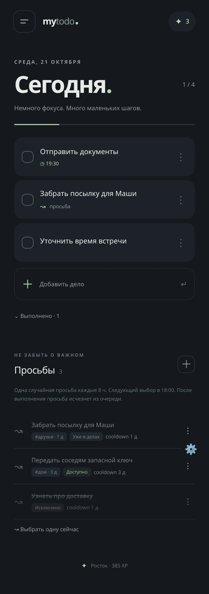
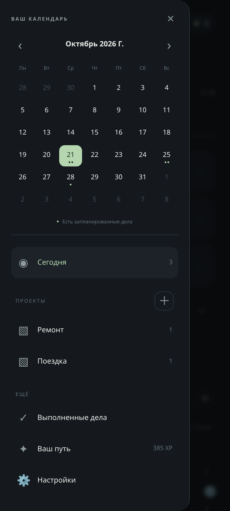

# My TODO

Минималистичное Android-приложение для маленьких шагов и больших замыслов. Работает полностью офлайн, без аккаунтов, аналитики и разрешения на доступ к интернету.

**[Скачать APK из последнего релиза](https://github.com/loxylon/My-TODO/releases/latest)** · Android 8.0+ · подходит для OnePlus 10T.

 

## Возможности

- Сегодня: чекбоксы, напоминания с датой и временем, редактирование, выполненные дела. Незавершённые задачи остаются на следующий день. Интерфейс расположен ниже системного статус-бара, учитывает вырез камеры и клавиатуру.
- Просьбы: одноразовые дела, о которых вас попросили. Теги, cooldown и исключения видны в очереди. После выполнения просьба исчезает из очереди; отмена выполнения возвращает её с прежними тегами.
- Одна случайная доступная просьба автоматически попадает в «Сегодня» каждые 8 часов по умолчанию. Интервал настраивается от 15 минут. Можно выбрать одну вручную.
- Планирование на дату: будущее дело не показывается в «Сегодня» до своего дня. Когда дата наступает, все дела этой даты одновременно появляются в сегодняшнем списке — независимо от автовыбора просьб.
- Проекты со своими списками; левое меню с мини-календарём. Точки под датой обозначают записанные дела, нажатие открывает список выбранного дня и позволяет добавить в него новое дело.
- Шесть тем: Sage, Dracula, Nord, Rosé Pine, Paper, Midnight.
- 60 рангов: +20 XP за первое выполнение задачи, +5 за её создание или создание проекта, +2 за изменение дела (один раз в день для каждого дела). Повторное переключение чекбокса не приносит XP.
- Экспорт и восстановление JSON-копий через системный выбор файла.

## Как выбираются просьбы

Интервал задаёт время следующего случайного выбора **одной** просьбы. Задачи, у которых уже есть незавершённая копия, и исключённые просьбы не участвуют в выборе. Cooldown и теги сохраняют правила доступности из первой версии; применяется наибольшая длительность. Собственный cooldown можно установить в 0, чтобы использовать только правила тегов.

После выполнения просьба удаляется из очереди, а выполненная задача остаётся в истории. Если снять отметку выполнения, просьба вернётся в очередь, но не сможет создать дубликат уже существующего незавершённого дела. Новую просьбу с тем же названием можно создать отдельно.

Если доступных просьб нет, выбор пропускается до следующего интервала. Пропущенные за время выключенного телефона интервалы не накапливаются: после возобновления добавляется максимум одна просьба.

## Даты и календарь

В редакторе дела есть отдельное поле **Дата**. Оно определяет, когда дело должно попасть в «Сегодня»; поле **Напомнить** отдельно задаёт время уведомления. Для проекта дату можно оставить пустой — такое дело останется только в проекте. Если назначить дату, дело в нужный день появится и в «Сегодня», сохранив принадлежность к проекту. Отметки календаря учитывают задачи с датой из всех проектов. Задача хранится в одном экземпляре: перенос по датам не создаёт копий.

Расписание использует локальную дату и часовой пояс телефона. В полночь пересчитывается сегодняшний список; если телефон был выключен или приложение остановлено, список обновится при следующем открытии. Дела на уже прошедшие даты сохраняются среди незавершённых.

## Установка и напоминания на OnePlus

1. Скачайте **My-TODO.apk** из Releases. Разрешите установку из браузера или файлового менеджера, если Android попросит.
2. В приложении откройте **Настройки → Уведомления** и разрешите их. В **Точное время напоминаний** разрешите будильники и напоминания.
3. В настройках OxygenOS откройте **Приложения → My TODO → Использование батареи** и разрешите фоновую работу. Названия пунктов зависят от версии OxygenOS.
4. Добавьте дело и укажите дату/время. Уведомления локальные, сервер и интернет им не нужны.

Без разрешения точных будильников используется системное приблизительное расписание. Doze и ограничения батареи могут задерживать автовыбор и напоминания; после принудительной остановки нужно снова открыть приложение. Запланированные события восстанавливаются после перезагрузки и обновления APK.

## Обновления без переустановки

Идентификатор **`dev.loxylon.todo`** постоянный. Релизный APK подписывается одним приватным RSA-ключом. Следующий APK с тем же ключом и большим `versionCode` устанавливается поверх предыдущего; локальные задачи, проекты, темы и XP сохраняются. Обновление устанавливается скачиванием нового APK, встроенной загрузки обновлений пока нет. Перед удалением приложения сохраните JSON-копию.

**Не заменяйте ключ подписи, не меняйте applicationId и не используйте debug APK для обновления релизной установки.**

В исходном облачном окружении приватный ключ находится **вне репозитория** в `/workspace/.todo-signing/release.jks`, пароль — в соседнем файле `credentials` с закрытыми правами. Не публикуйте эти файлы и не создавайте новый ключ для следующих версий. До удаления окружения сохраните их в своём менеджере секретов.

Настроен отдельный workflow **Signed release**. Для его использования один раз добавьте в **Settings → Secrets and variables → Actions** репозитория:

- `TODO_KEYSTORE_BASE64` — base64 исходного `release.jks`;
- `TODO_STORE_PASSWORD` — пароль хранилища;
- `TODO_KEY_PASSWORD` — пароль ключа (в первой версии совпадает с паролем хранилища).

GitHub-интеграция текущего окружения не имеет доступа к управлению Actions secrets; автоматически добавить их не удалось. Ключ сохранён локально в окружении. Для загрузки уже подписанного файла в релиз используется workflow **Publish verified APK**: он проверяет SHA-256, исходный сертификат подписи и версию APK, а затем загружает файлы из `release/` в тег, указанный в `release/VERSION`. Приватный ключ этому workflow не нужен. Workflow **Signed release** сможет самостоятельно собирать следующие версии после настройки секретов.

Для очередной версии измените `versionCode` и `versionName` в `app/build.gradle`, обновите приложение, выполните проверки, затем запустите Signed release с соответствующим тегом `vX.Y.Z`. В исходном окружении можно собрать тем же ключом через `bash scripts/build-release.sh`.

## Разработка и проверки

Требуются JDK 21, Android SDK Platform 35 / Build Tools 35.0.0, Node 22+, Python 3 и Chromium для тестов интерфейса. Gradle 8.14.3 загружается wrapper-скриптом с проверкой SHA-256.

```bash
# В подготовленном облачном окружении
source scripts/cloud-env.sh
npm ci
npm test                         # правила выбора, cooldown, XP, ранги, JSON
npm run test:ui                  # реальные действия в Chromium, мобильный размер
./gradlew testDebugUnitTest lintRelease assembleDebug
bash scripts/build-release.sh    # исходный приватный ключ, release APK, SHA-256
```

На другой машине укажите `JAVA_HOME` и `ANDROID_HOME`. Если Chromium находится не в `/usr/bin/chromium`, задайте `CHROMIUM_PATH`. Android Studio может открыть проект напрямую. `npm run preview` служит только для локальной разработки интерфейса: системные уведомления и фоновые будильники работают в Android-приложении.

## Устройство проекта

- `app/src/main/assets/` — полностью локальный HTML/CSS/JS-интерфейс; CSP, экранирование пользовательского ввода, без удалённых страниц.
- `MainActivity.java` — WebView и узкий мост к Android, разрешения, системный импорт/экспорт.
- `Store.java`, `PoolPicker.java` — постоянное JSON-состояние в SharedPreferences и случайный выбор.
- `Alarms.java`, `AlarmReceiver.java`, `BootReceiver.java` — системные напоминания и восстановление расписания.
- `tests/` — тесты модели и сценарии интерфейса; `app/src/test/` — JVM-тесты политики фонового выбора.

Версия приложения 1.1.0 использует схему данных 2. Старая схема 1 и JSON-копии версии 1.0 автоматически преобразуются: задачи, проекты, теги, тема и XP сохраняются; завершённые просьбы убираются из очереди. Активные просьбы сохраняются. При изменении схемы в будущих версиях добавляйте миграцию, не очищая SharedPreferences.
