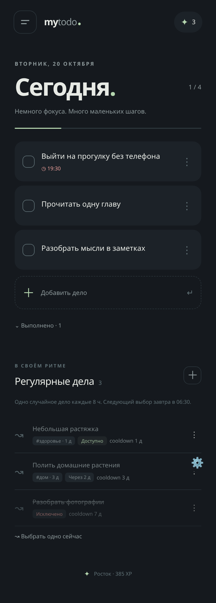
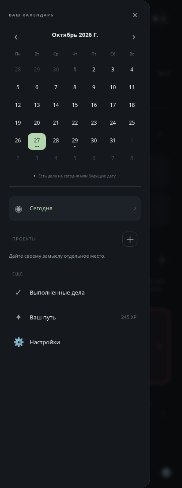
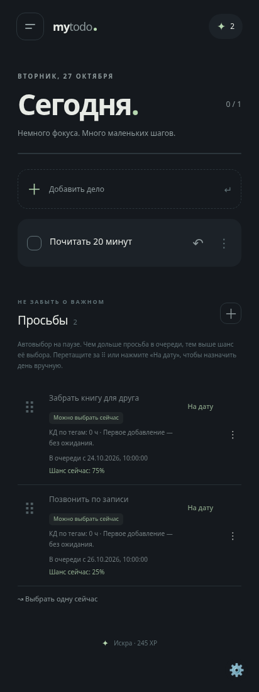
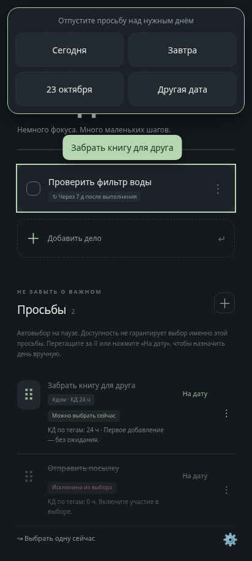
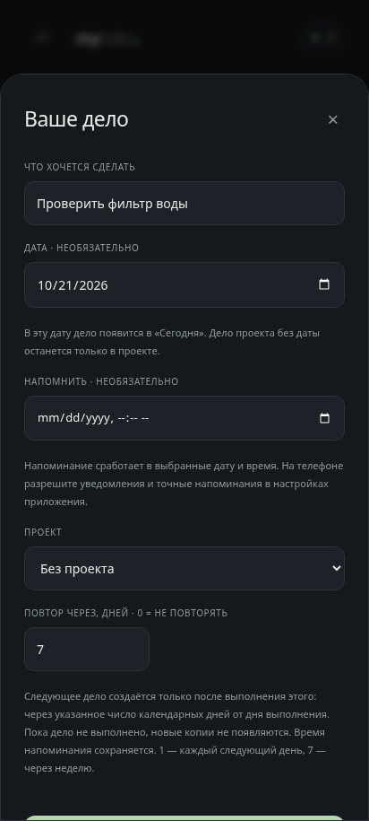

# My TODO

Минималистичное Android-приложение для маленьких шагов и больших замыслов. Работает полностью офлайн, без аккаунтов, аналитики и разрешения на доступ к интернету.

**[Скачать APK релиза 1.7.0](https://github.com/loxylon/My-TODO/releases/tag/v1.7.0)** · Android 8.0+ · подходит для OnePlus 10T.

**Переход с 1.6.0 требует JSON-копии:** исходный ключ подписи 1.6.0 утрачен, поэтому APK 1.7.0 не установится поверх неё. В установленной 1.6.0 экспортируйте JSON через **Настройки → Ваши данные**, проверьте наличие файла, удалите 1.6.0, установите 1.7.0 и восстановите JSON. Удаление без копии удалит локальные данные. Следующие версии, подписанные новым ключом 1.7.0, смогут устанавливаться поверх неё.

 

## Возможности

- Сегодня: чекбоксы, напоминания с датой и временем, редактирование, выполненные дела. Кнопка добавления расположена над списком, под прогрессом. После окончания дня незавершённые задачи перемещаются в очередь просьб с тегом **просроченные** и выключенным участием в выборе. Интерфейс расположен ниже системного статус-бара, учитывает вырез камеры и клавиатуру.
- Просьбы: одноразовые дела, о которых вас попросили. Теги, cooldown и исключения видны в очереди. После выполнения просьба исчезает из очереди; отмена выполнения возвращает её с прежними тегами.
- Одна случайная доступная просьба автоматически попадает в «Сегодня» каждые 8 часов по умолчанию. Интервал настраивается от 15 минут. Можно выбрать одну вручную. Чем дольше просьба ждёт в очереди, тем выше её шанс среди доступных.
- Ручной перенос просьб: потяните за **⠿** и отпустите над «Сегодня», «Завтра» или другим днём. Для любой даты есть зона «Другая дата» и кнопка **На дату** у просьбы. Перенесённая просьба уходит из очереди, сохраняя теги для возможного возврата как просроченной.
- Возврат дел в просьбы: кнопка **↶** показывается только у незавершённых дел, которые изначально были просьбами. Сохраняются задача, проект, теги, повтор и XP.
- Просроченные: яркая красная пометка в очереди и при добавлении в дела на день, с исходной датой просрочки.
- Повторяющиеся дела: один следующий экземпляр через указанный интервал после фактического выполнения предыдущего, без накопления пропущенных повторов.
- Планирование на дату: будущее дело не показывается в «Сегодня» до своего дня. Когда дата наступает, все дела этой даты одновременно появляются в сегодняшнем списке — независимо от автовыбора просьб.
- Проекты со своими списками; левое меню с мини-календарём. Точки под датой обозначают дела на сегодня и будущие дни; отметки прошедших дат исчезают, нажатие открывает список выбранного дня и позволяет добавить в него новое дело.
- Шесть тем: Sage, Dracula, Nord, Rosé Pine, Paper, Midnight.
- 60 рангов: +8 XP за первое выполнение задачи, +1 за создание дела, просьбы или проекта, +1 за изменение дела или просьбы (один раз в день для каждой записи). Уже заработанные XP и ранги сохраняются. Повышение ранга сопровождается отдельным праздничным экраном.
- Экспорт и восстановление JSON-копий через системный выбор файла.

## Как выбираются просьбы

Интервал задаёт частоту случайного выбора **одной** доступной просьбы. Все просьбы **без тега** делят общий КД **2 дня**. Для каждого тега в настройках задаётся отдельный КД; выбор любой просьбы с этим тегом запускает паузу **для всего тега**. Если тегов несколько, просьба ждёт окончания паузы каждого из них. Новая просьба в ещё не использованной группе доступна сразу. Собственные КД просьб из старых версий не действуют; при обновлении время последнего выбора каждой группы восстанавливается из прежних записей. В списке и редакторе показывается один из точных статусов:

- **Можно выбрать** — просьба участвует в случайном автовыборе и выборе кнопкой «Выбрать одну сейчас».
- **Доступна с ДД.ММ.ГГГГ, ЧЧ:ММ:СС** — абсолютное время по часам телефона и обратный отсчёт до него; КД группы указан отдельно.
- **Уже в делах** — повторный выбор заблокирован, чтобы не создать копию задачи.
- **Не участвует** — участие выключено; окончание КД само по себе не включит просьбу.

Вероятность выбора пропорциональна времени нахождения в очереди: **шанс = время ожидания просьбы / суммарное время ожидания доступных просьб**. Например, если доступны только две просьбы с ожиданием 3 дня и 1 день, их шансы — 75% и 25%. Только что добавленная просьба имеет минимальный ненулевой вес; время учитывается непрерывно, без округления до суток. При равном ожидании шансы одинаковы.



У каждой просьбы показаны начало отсчёта и **Шанс**. Число обновляется каждую секунду и учитывает только доступные просьбы: исключённые, ожидающие cooldown или уже находящиеся в делах получают 0%. Очень маленький ненулевой шанс показывается как «меньше 0,1%», а близкий к 100% — как «больше 99,9%». Автовыбор Android в фоне и кнопка **Выбрать одну сейчас** используют одинаковые веса. Ручное назначение через **На дату** выбирает указанную просьбу независимо от весов.

Дата добавления сохраняется в JSON и после перезапуска, редактирования или паузы. Возврат дела в очередь и перенос в просроченные начинают новый период ожидания, сохраняя прежние правила участия. В старых версиях дата добавления не записывалась: для таких записей общий отсчёт начинается при первом обновлении или импорте старой копии; в интерфейсе это подписано **Возраст учитывается с**. Обновление сохраняет исходный JSON в **Копия до обновления**. Копии новой версии сохраняют уже накопленный возраст.

Доступность не означает, что следующей будет выбрана именно эта просьба: общий автовыбор отдельно выбирает одну случайную из доступных. Его следующий запуск указан в заголовке очереди. Статус КД обновляется каждую секунду.

После выполнения просьба удаляется из очереди, а выполненная задача остаётся в истории. Если снять отметку выполнения, просьба вернётся в очередь, но не сможет создать дубликат уже существующего незавершённого дела. Новую просьбу с тем же названием можно создать отдельно.

Перетаскивание за **⠿** и кнопка **На дату** назначают день вручную независимо от cooldown и исключения из автовыбора. Если просьба уже была выбрана автоматически, переносится существующая задача без создания копии. Ручной перенос убирает просьбу из очереди; отмена выполнения оставляет её обычным делом на назначенную дату. При просрочке она возвращается в очередь с прежними тегами и новым тегом **просроченные**, с выключенным участием в выборе.

Если доступных просьб нет, выбор пропускается до следующего интервала. Пропущенные за время выключенного телефона интервалы не накапливаются: после возобновления добавляется максимум одна просьба.

## Даты и календарь

В редакторе дела есть отдельное поле **Дата**. Оно определяет, когда дело должно попасть в «Сегодня»; поле **Напомнить** отдельно задаёт время уведомления. Для проекта дату можно оставить пустой — такое дело останется только в проекте. Если назначить дату, дело в нужный день появится и в «Сегодня», сохранив принадлежность к проекту. Отметки календаря учитывают задачи с датой из всех проектов только на сегодня и будущие дни. В местную полночь точки прошедшего дня исчезают, в том числе в уже открытом календаре. Записи задач и выполненная история сохраняются; прошедшую дату можно открыть без точек. Задача хранится в одном экземпляре: перенос по датам не создаёт копий.

Расписание использует локальную дату и часовой пояс телефона. В полночь все невыполненные дела прошедшего дня перемещаются в очередь просьб, получают тег **просроченные** и выключенное участие в выборе. Если телефон был выключен или приложение остановлено, перенос выполняется при следующем открытии. Он работает и при выключенном автовыборе. Выполненные дела, будущие задачи и задачи проектов без даты не переносятся.

После обновления формата или восстановления JSON записи остаются в своих прежних списках и на прежних датах: первый запуск не переносит их в просьбы и не запускает немедленный автовыбор. Обычный перенос просроченных снова срабатывает со следующей местной полуночи.

Уже существующая просьба обновляется без дубликата; остальные теги и правила сохраняются. Тег **просроченные** создаётся один раз с cooldown 0, а существующий одноимённый тег переиспользуется. При повторном выборе сохраняются исходная задача, проект и ранее заработанный опыт; истёкшее напоминание очищается. Просроченные по умолчанию исключаются из случайного выбора при каждом переносе из списка дел. Их можно назначить вручную через **На дату** или включить переключателем **Участвует в выборе**. В очереди они выделены красной карточкой и яркой плашкой; выключенный автовыбор не приглушает их. В делах на день они отмечены как **Просрочено**, с исходной датой, вместо подписи «просьба». Последующие переносы не меняют первую дату просрочки. Новый день не приносит XP.

## Возврат в просьбы

У незавершённого дела, созданного из просьбы, нажмите **↶** или откройте его редактор и выберите **Вернуть в просьбы**. Обычные дела и новые экземпляры повторяющихся задач не имеют этой кнопки. Дело исчезнет из списка дня, а точка календаря пересчитается. Если его просьба уже находилась в очереди после автовыбора, обновится та же запись без дубликата. После повторного выбора восстанавливается та же задача с прежними проектом, тегами, настройкой повтора и отметкой ранее начисленного XP.

Возвращённая просьба сохраняет общий КД своего тега или группы без тега. Саму просьбу можно назначить вручную даже во время ожидания. Сам возврат не приносит XP и не запускает немедленный автовыбор. Просроченное возвращается с выключенным участием и красной пометкой. Для выполненного дела сначала снимите отметку выполнения; у повторяющегося это также отменит ещё не выполненный следующий экземпляр.

## Повторяющиеся дела

В форме создания или редактирования дела задайте **Повтор через, дней**: 0 выключает повтор, 1 означает следующий календарный день после выполнения, 7 — через неделю. Интервал допускает целое число до 3650 дней. Первую дату выбирайте в обычном поле даты. Повторяющееся дело проекта всегда имеет дату и появляется также в «Сегодня».

Например, дело с интервалом 3 дня было назначено на 21 октября, но выполнено 25 октября: следующий экземпляр получит дату **28 октября**. Он создаётся при выполнении предыдущего и заранее виден в календаре; в «Сегодня» появляется в свою дату. Пока текущий экземпляр не выполнен, новые не создаются. Просроченный повтор переходит в просьбы по общему правилу и сохраняет интервал; следующий появится только после выполнения возвращённого дела. Проект, название и время напоминания наследуются, XP начисляется за выполнение каждого нового экземпляра.

Отмена выполнения убирает ещё не выполненный следующий экземпляр, даже если тот уже попал в просроченные просьбы. Если следующие повторы уже выполнены, сначала отмените их выполнение в истории в обратном порядке. Чтобы прекратить серию, задайте 0 у её текущего невыполненного дела или удалите его. Изменения завершённого экземпляра не меняют уже созданный следующий.

 

## Установка и напоминания на OnePlus

1. Скачайте **My-TODO.apk** из Releases. Разрешите установку из браузера или файлового менеджера, если Android попросит.
2. В приложении откройте **Настройки → Уведомления** и разрешите их. В **Точное время напоминаний** разрешите будильники и напоминания.
3. В настройках OxygenOS откройте **Приложения → My TODO → Использование батареи** и разрешите фоновую работу. Названия пунктов зависят от версии OxygenOS.
4. Добавьте дело и укажите дату/время. Уведомления локальные, сервер и интернет им не нужны.

Без разрешения точных будильников используется системное приблизительное расписание. Doze и ограничения батареи могут задерживать автовыбор и напоминания; после принудительной остановки нужно снова открыть приложение. Запланированные события восстанавливаются после перезагрузки и обновления APK.

## Обновления без переустановки

Идентификатор **`dev.loxylon.todo`** постоянный. Релизы начиная с 1.7.0 должны подписываться одним приватным RSA-ключом. Следующий APK с тем же ключом и большим `versionCode` устанавливается поверх предыдущего; локальные задачи, проекты, темы и XP сохраняются. Обновление устанавливается скачиванием нового APK, встроенной загрузки обновлений пока нет. Для перехода с 1.6.0 используйте JSON-копию по инструкции выше.

**Не заменяйте ключ подписи, не меняйте applicationId и не используйте debug APK для обновления релизной установки.**

## Совместимость JSON и защита существующих данных

Исходники версии 1.7.0 читают JSON-копии **1.0.0, 1.1.0, 1.2.0, 1.3.0, 1.4.0, 1.5.0 и 1.6.0**, а также свои копии. Миграция сохраняет все задачи, просьбы, их порядок, даты, связи с проектами, теги, выполненные отметки, историю, тему и XP. Даже старые завершённые просьбы не удаляются миграцией. Сохранённые настройки участия существующих просьб при импорте не меняются. Новое правило выключенного участия применяется при следующем переносе просроченного дела в очередь. Старые собственные КД обнуляются по правилу версии 1.3; КД тегов сохраняются.

Перед миграцией исходный JSON сохраняется локально без изменений. Перед подтверждённым восстановлением импортируемого JSON текущие данные тоже автоматически копируются. В **Настройки → Ваши данные** доступны **Копия до обновления** и **Копия до восстановления**: их можно выгрузить в JSON и затем восстановить обычным способом. Хранится копия перед последней операцией каждого типа. Отмена импорта и ошибки проверки файла не заменяют текущие данные.

Совместимость проверяется для перехода со старой версии на новую. Старые APK могут не читать новый формат схемы 3. Неизвестная будущая или повреждённая схема отклоняется без очистки существующей базы. Тестовые JSON получены кодом моделей выпущенных тегов и находятся в `tests/fixtures/backups/`.

Исходный приватный ключ 1.6.0 утрачен, поэтому 1.7.0 подписана новым ключом и не устанавливается поверх неё. Новый ключ находится только в приватных файлах облачного окружения `/workspace/.todo-signing-v2/release.jks` и `/workspace/.todo-signing-v2/credentials`; **сохраните оба файла в надёжном месте**, чтобы следующие релизы могли устанавливаться поверх 1.7.0. В Git и GitHub Releases ключ и пароль не публикуются. SHA-256 сертификата нового APK: `628858f6b91f828f8fe8c7ddd838cc8d7e14b7bf8ecac1a823a872d1361073bc`.

Настроен отдельный workflow **Signed release**. Для его использования один раз добавьте в **Settings → Secrets and variables → Actions** репозитория:

- `TODO_KEYSTORE_BASE64` — base64 ключа подписи 1.7.0 `release.jks`;
- `TODO_STORE_PASSWORD` — пароль хранилища;
- `TODO_KEY_PASSWORD` — пароль ключа (совпадает с паролем хранилища).

GitHub-интеграция текущего окружения не имеет доступа к управлению Actions secrets; автоматически добавить их не удалось. Для загрузки уже подписанного файла в релиз используется workflow **Publish verified APK**: он проверяет SHA-256, сертификат подписи 1.7.0 и версию APK, затем создаёт релиз по `release/VERSION` и прикладывает файлы из `release/`. Приватный ключ этому workflow не нужен. Workflow **Signed release** сможет самостоятельно собирать следующие версии после настройки секретов.

При локальной сборке следующих релизов укажите `TODO_KEYSTORE`, `TODO_STORE_PASSWORD` и `TODO_KEY_PASSWORD` для нового ключа. Сверьте сертификат APK с отпечатком выше перед публикацией.

## Разработка и проверки

Требуются JDK 21, Android SDK Platform 35 / Build Tools 35.0.0, Node 22+, Python 3 и Chromium для тестов интерфейса. Gradle 8.14.3 загружается wrapper-скриптом с проверкой SHA-256.

```bash
# В подготовленном облачном окружении
source scripts/cloud-env.sh
npm ci
npm test                         # правила выбора, cooldown, XP, ранги, JSON
npm run test:ui                  # реальные действия в Chromium, мобильный размер
./gradlew testDebugUnitTest lintRelease assembleDebug
bash scripts/build-release.sh    # приватный ключ 1.7.0, release APK, SHA-256
```

На другой машине укажите `JAVA_HOME` и `ANDROID_HOME`. Если Chromium находится не в `/usr/bin/chromium`, задайте `CHROMIUM_PATH`. Android Studio может открыть проект напрямую. `npm run preview` служит только для локальной разработки интерфейса: системные уведомления и фоновые будильники работают в Android-приложении.

## Устройство проекта

- `app/src/main/assets/` — полностью локальный HTML/CSS/JS-интерфейс; CSP, экранирование пользовательского ввода, без удалённых страниц.
- `MainActivity.java` — WebView и узкий мост к Android, разрешения, системный импорт/экспорт.
- `Store.java`, `PoolPicker.java` — постоянное JSON-состояние в SharedPreferences и случайный выбор.
- `Alarms.java`, `AlarmReceiver.java`, `BootReceiver.java` — системные напоминания и восстановление расписания.
- `tests/` — тесты модели и сценарии интерфейса; `app/src/test/` — JVM-тесты политики фонового выбора.

Версия приложения 1.6.0 сохраняет схему данных 3; поля повторов, ручного переноса, исходной даты просрочки и времени добавления в очередь необязательны. Для старой базы добавляется общий момент начала учёта возраста без изменения её записей; исходный JSON сохраняется отдельно. У новых просьб поле queuedAt, у базы — queueClockStartedAt. Время ожидания сохраняется при восстановлении новых копий. При восстановлении нового JSON сохраняются интервал и связи повторов, даты следующего дела и сведения об исходной просьбе. Старые APK могут сохранить эти поля, но не поддерживают новую механику; для восстановления используйте текущий APK. Форматы 1 и 2 преобразуются без удаления записей; исходная база сохраняется отдельно перед записью новой. При изменении схемы в будущих версиях добавляйте такую же миграцию и проверки старых JSON, не очищая SharedPreferences.
